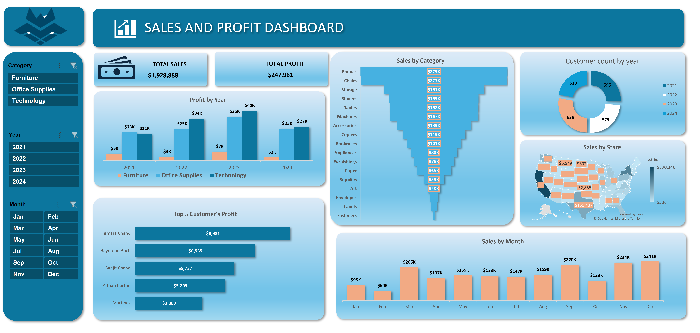

# Sales & Profit Performance Dashboard (2021–2024)

## 1. Executive Summary
This project analyses **8,314 retail transaction records** spanning **January 2021 through August 2024** across **48 contiguous U.S. states plus Washington, D.C.** The objective was to transform raw transactional order logs into an interactive, executive-ready Excel dashboard capable of tracking top-line revenue, bottom-line profitability, product-line margin leakage, regional performance, and seasonal demand.

* **Total Revenue:** $1,928,887.86 across 31,508 units sold
* **Total Net Profit:** $247,961.07 (**12.86% overall profit margin**)
* **Customer Base:** 789 unique customers across 1,829 distinct products
* **Core Discovery:** While **Furniture** generates 32.3% of total revenue ($622,342.10), it contributes only **7.2% of total profit** ($17,888.67; **2.87% margin**) due to heavy losses in **Tables** (-$12,327.06) and **Bookcases** (-$2,428.25). Meanwhile, **Technology** ($121,861.73 profit; **17.30% margin**) and **Office Supplies** ($108,210.67 profit; **17.97% margin**) drive 92.8% of company profitability.

---

## 2. Data Architecture & Cleaning Pipeline
The workbook is structured into a three-tier analytical architecture separating raw storage, dynamic aggregation, and visual presentation:

1. **`DATA` Sheet (Fact Table):** 8,314 rows × 11 columns (`Order Date`, `Customer Name`, `State`, `Category`, `Sub-Category`, `Product Name`, `Sales`, `Quantity`, `Profit`, `Month`, `Year`).
2. **`PIVOT` Sheet (Analytical Engine):** Houses 7 Pivot Tables and dynamic helper tables powered by `GETPIVOTDATA` formulas to decouple chart data from Pivot Table layout shifts.
3. **`DASHBOARD` Sheet (Presentation Layer):** Interactive executive view featuring KPI cards, charts, and Slicers for self-service filtering.

### Data Quality & Preparation Steps Executed
* **Completeness & Integrity Audit:** Verified **0 null/missing values** and **0 duplicate order rows** across all 8,314 records.
* **Standardisation & Type Enforcement:** Formatted `Order Date` as ISO dates (`YYYY-MM-DD`), enforced currency precision on `Sales` and `Profit`, and standardised integer types on `Quantity` and `Year`.
* **Feature Engineering (Temporal Attributes):** Extracted `Month` (3-letter abbreviated text: `Jan`–`Dec`) and `Year` (`2021`–`2024`) from `Order Date` to enable multi-year seasonality and year-over-year (YoY) slicing without altering the source timestamps.
* **Geographic & Temporal Scope Validation:** Confirmed coverage across 49 jurisdictions (all U.S. states excluding Alaska and Hawaii) and identified a partial-year boundary in 2024 (`Jan`–`Aug`), ensuring apples-to-apples YTD comparisons when evaluating 2024 growth.

---

## 3. Technical Implementation: Pivot Tables & Excel Formulas
Rather than linking dashboard visuals directly to volatile Pivot Table ranges, this model uses a **Staging / Helper Table architecture** inside the `PIVOT ` tab so charts never break when slicers filter the dataset.

| Dashboard Component | Pivot Source (`PIVOT ` Tab) | Exact Excel Formulas Used | Technical Purpose |
| :--- | :--- | :--- | :--- |
| **KPI Cards (Sales & Profit)** | Cells `A4:A10` | `=GETPIVOTDATA("Sales",$A$4)` `=GETPIVOTDATA("Profit",$A$9)` | Dynamically extracts grand totals for top-level KPI cards regardless of filter state. |
| **Sales by Sub-Category** | Pivot `I4:J22` → Helper `L4:M21` | `=I5` `=GETPIVOTDATA("Sales",$I$4,"Sub-Category",L5)` | Mirrors all 17 sub-categories into a static range so bar charts remain cleanly formatted during slicer updates. |
| **Geographic Map / State Sales** | Pivot `U4:V54` → Helper `X4:Y53` | `=U5` `=GETPIVOTDATA("Sales",$U$4,"State",X5)` | Feeds Excel's Filled Map visual (which cannot bind directly to a Pivot Table) across all 49 states. |
| **Monthly Seasonality Trend** | Pivot `AD4:AE17` → Helper `AF5:AF16` | `=GETPIVOTDATA("Sales",$AD$4,"Month",AD5)/100` | Normalises monthly sales figures for clean axis scaling on the monthly trend chart. |
| **Profit by Year & Category** | Cross-Tab Pivot `C4:G10` | Pivot Value Field: `Sum of Profit` (Rows: `Year`, Columns: `Category`) | Tracks multi-year profit expansion across Furniture, Office Supplies, and Technology. |
| **Top 5 Customers by Profit** | Filtered Pivot `AA4:AB10` | Pivot Top-5 Value Filter on `Sum of Profit` | Isolates the top 5 profit-generating accounts (**$30,763.84 combined profit**, or **12.41%** of total company profit). |
| **Active Customer Count** | Pivot `R4:S9` | Pivot Value Field: `Count of Customer Name` by `Year` | Tracks annual customer engagement volume (`595` in 2021 → `638` in 2023). |

---

## 4. Key Analytical Findings & Business Insights
* **Strong YTD Momentum in 2024:** Because 2024 data runs through August, comparing `Jan–Aug` across years reveals accelerating performance: `Jan–Aug` sales grew **+21.93%** from **$299,585.77** (2023) to **$365,294.45** (2024), while `Jan–Aug` profit surged **+60.26%** from **$34,318.31** to **$54,999.32** (lifting overall margin from 10.24% in 2021 to **15.06%** in 2024).
* **Sub-Category Margin Leakage:** Out of 8,314 orders, **1,549 transactions were unprofitable**, generating **-$123,375.15** in cumulative losses. **Tables** ($167,672.76 sales; **-7.35% margin**) and **Bookcases** ($101,387.67 sales; **-2.39% margin**) are the primary profit drains, whereas **Phones** ($279,464.42 sales; **13.44% margin**) and **Binders** ($169,089.73 sales; **17.88% margin**) are top profit engines.
* **Geographic Concentration vs. Profitability:** **California** ($390,145.54 sales; $63,144.57 profit) and **New York** ($246,517.74 sales; $57,223.84 profit) account for **33.01% of total revenue** and **48.54% of net profit**. Conversely, **Texas** ($151,436.60 sales; **-$21,067.53 profit**) and **Pennsylvania** ($95,494.86 sales; **-$11,853.20 profit**) rank in the top 5 for revenue but generate severe net losses.
* **Q4 & March Seasonality Peaks:** Revenue peaks sharply in **December** ($241,464.23), **November** ($234,013.28), **September** ($219,783.30), and **March** ($205,005.51), while **February** ($59,640.16) represents the lowest seasonal trough.

---

## 5. Strategic Recommendations
1. **Audit Discounting & Shipping Costs in Loss-Making States:** Conduct a pricing and freight review in **Texas** and **Pennsylvania**, and cap promotional discounting on **Tables** and **Bookcases** where high revenue is actively eroding net margin.
2. **Reallocate Inventory & Marketing Toward High-Margin Tech/Supplies:** Prioritize Q4 inventory allocation for **Phones**, **Chairs**, and **Binders**, which combine high order velocity with double-digit margins.
3. **VIP Retention Program:** Establish dedicated account management for top-profit buyers—led by **Tamara Chand** ($8,981.32 profit) and **Raymond Buch** ($6,939.17 profit)—since the top 5 customers alone generate over 12% of total net profit.
